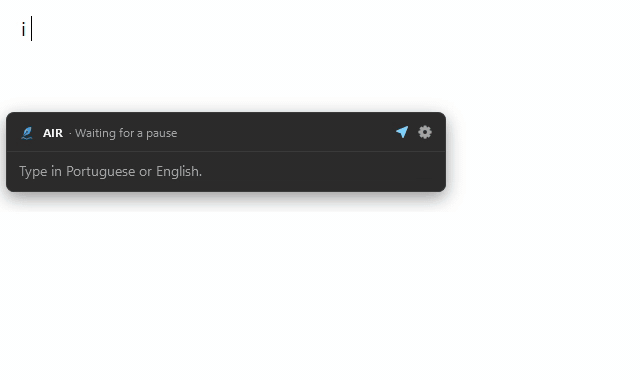
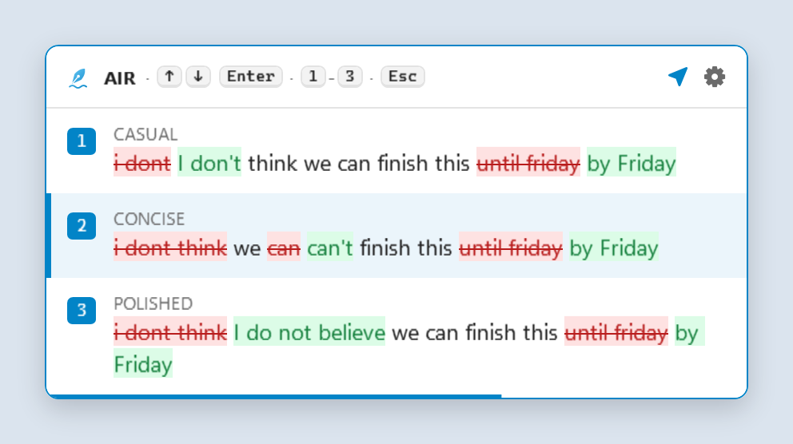
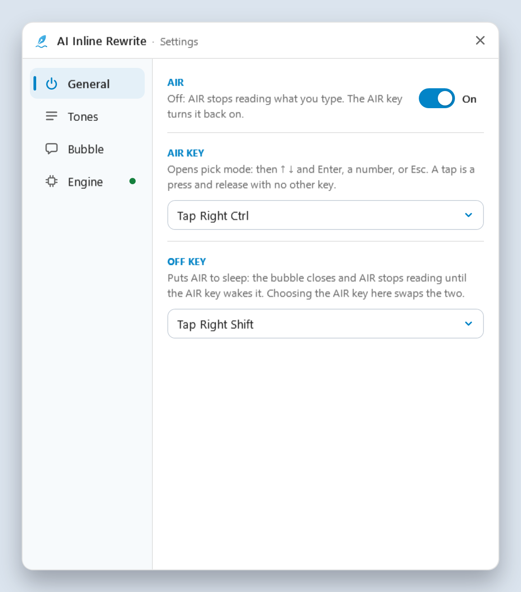
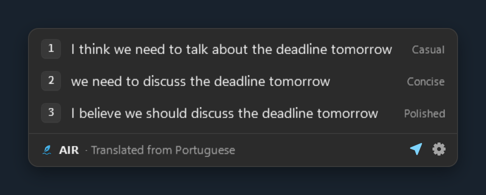
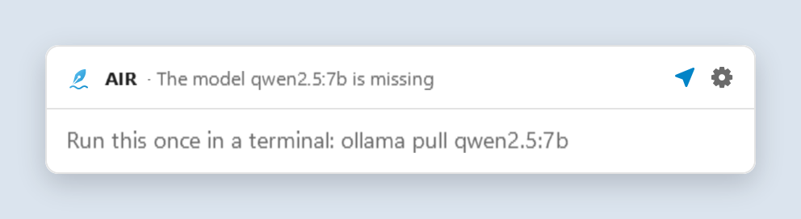

# AI Inline Rewrite

<picture>
  <source media="(prefers-color-scheme: dark)" srcset="docs/logo-dark.png" />
  
</picture>

Type in your language, get it rewritten right where you type. A small Windows tray app: write a sentence in
Portuguese or in English in any app, pause, and a bubble under the text cursor offers it in clean English, in a few
tones. Pick one with a key and it replaces what you typed. AIR for short.

It runs locally by default: an open model (Qwen2.5 7B) inside AIR itself, on your PC, downloaded once on the first
start, or taken from [Ollama](https://ollama.com) when Ollama already has it. Ollama is a second engine, and Claude
through the Anthropic API a third, for when you would rather not run a model yourself (no video card, for one); the
Claude engine is [not validated yet](TODO.md#not-validated-yet): it was tested only against a fake Anthropic API.

[](https://github.com/rbritta/ai-inline-rewrite/actions/workflows/ci.yml)
[](https://github.com/rbritta/ai-inline-rewrite/releases/latest)
[](LICENSE)

<div align="center">



<sub>The real app on the reference machine, with <code>qwen2.5:7b</code> on its GPU, in real time.</sub>

</div>

[Engines](#engines) · [Install](#install) · [Use it](#use-it) · [Tones](#tones) · [Languages](#languages) ·
[Settings](#settings) · [What to expect](#what-to-expect) · [Privacy](#privacy) · [Develop](#develop) ·
[For AI agents](AGENTS.md) · [Roadmap](TODO.md)

## What it does

For people who write English at work in their second language. You type the way you think, in Portuguese or in
rough English, in Slack, Outlook, a browser, Notepad, anywhere with a text field. When you pause, AIR reads the
sentence you are typing and writes it again in English, once per tone:

- **Portuguese is translated.** "acho que a gente precisa conversar sobre o prazo amanhã" comes back as "I think we
  need to talk about the deadline tomorrow", or "we need to talk about the deadline tomorrow" in Concise.
- **English is corrected**, and the bubble shows exactly what changed: struck-through red for the words that go,
  green for the ones that come in.
- **Your shape is kept.** The version ends with the punctuation you typed (or none) and starts with the case you
  typed, so it drops into your text as if you had written it.

Then tap the **AIR key** (Right Ctrl, alone) and pick a version: it replaces your sentence in place. Or ignore it
and keep typing: the versions clear, and new ones come at the next pause. The bubble stays by your text while AIR is
on; when you want it gone, tap **Right Shift** alone (the off key) to put AIR to sleep (or turn it off in the
settings or the tray menu), and the AIR key brings it back.

## Engines

AIR asks a language model for each version, through one of three engines:

| | Built-in (default) | Ollama | Claude ([not validated yet](TODO.md#not-validated-yet)) |
|---|---|---|---|
| Where the model runs | inside AIR, on your PC: Qwen2.5 7B Instruct (Apache 2.0), through llama.cpp | in Ollama, on your PC: `qwen2.5:7b`, the same model | at Anthropic: Claude Haiku 5.5 by default |
| You need | nothing more: the model downloads once from the settings (4.7 GB), or comes from Ollama's copy | Ollama and the model (a 4.7 GB download) | internet and an Anthropic API key |
| On the [reference machine](docs/ENGINES.md#reference-machine) | 4.6 GiB of video memory; a median of 0.44 s per version on its GPU (Vulkan) | 4.6 GiB of video memory; a median of 0.13 s per version on its GPU, 2.1 s on 8 CPU threads | not measured: live calls are [not validated yet](TODO.md#not-validated-yet) |
| Cost | free; the model holds memory while loaded | free; the same | billed per token by Anthropic ([pricing](https://platform.claude.com/docs/en/about-claude/pricing)) |
| Your sentence | stays on your PC | stays on your PC | goes to Anthropic's API |

[docs/ENGINES.md](docs/ENGINES.md) has the reference machine and what was measured on it (memory, speed, three other
Ollama models), how long Ollama keeps the model loaded and how to free it, the Claude models and setup, other
backends, Docker, and the platforms. The Claude engine was tested only against a fake Anthropic API so far.
[docs/MODELS.md](docs/MODELS.md) compares eight Ollama models: quality judged blind, speed, size and license.

## Install

<a href="https://apps.microsoft.com/detail/9pc04775lgm1?mode=direct"></a>

1. **AIR.** Install it from the [Microsoft Store](https://apps.microsoft.com/detail/9pc04775lgm1?mode=direct): the
   Store keeps it updated, and the package is signed by Microsoft, so SmartScreen does not ask.

   Or without the Store: download `AiInlineRewrite-vX.Y.Z-win-x64.zip` from
   [Releases](https://github.com/rbritta/ai-inline-rewrite/releases/latest), unzip it anywhere and run
   `AiInlineRewrite\AiInlineRewrite.exe`. The folder is self-contained: no installer, no .NET to install. The exe is
   not code-signed yet ([code signing policy](CODE_SIGNING.md)), so SmartScreen may ask you to confirm the first run;
   the Release carries a checksum and a build attestation to [verify the download](SECURITY.md#verifying-a-download).
   Updates are by hand: a new zip from Releases.

2. **The model.** On the first start the settings open at the Engine section: click *Download* and AIR fetches its
   model once (4.7 GB, from the Qwen team's repository on Hugging Face), with a progress bar; when the connection
   drops it tries again by itself, and after a cancel it resumes where it stopped. If Ollama already has `qwen2.5:7b` on the PC, AIR uses that file and downloads nothing.
   Or pick another engine there instead:
   - **Ollama.** Install it from [ollama.com](https://ollama.com), pull the model once (`ollama pull qwen2.5:7b`)
     and pick Ollama in the settings.
   - **Claude.** Create an API key in the [Claude Console](https://platform.claude.com/settings/keys), store it as
     the user environment variable `ANTHROPIC_API_KEY`, start AIR again and pick Claude
     ([docs/ENGINES.md](docs/ENGINES.md#set-it-up) walks through it, `ant auth login` included).
     [Not validated yet](TODO.md#not-validated-yet) against the live API.

3. **Start with Windows** (optional): right-click the tray icon and check *Start with Windows*. The Store version
   also lists it in Task Manager under *Startup apps*.

**Uninstall.** From the Store: Settings > Apps > Installed apps > AI Inline Rewrite > Uninstall. Windows removes the
app, its startup entry and what it saved, the downloaded model included; the only exception is a settings or model
folder a zip copy of AIR made before, which stays where it was ([PRIVACY.md](PRIVACY.md)).

From the zip: uncheck *Start with Windows* in the tray menu (that deletes its value under
`HKCU\Software\Microsoft\Windows\CurrentVersion\Run`), quit AIR from the tray, and delete the `AiInlineRewrite`
folder, the folder `%AppData%\AiInlineRewrite` (the settings, and the log when it was on) and the folder
`%LocalAppData%\AiInlineRewrite` (the downloaded model). AIR writes nothing else.

Windows 11, 64-bit. Windows 10 64-bit was [not tested yet](TODO.md#not-validated-yet). Windows only: AIR is made of
Windows desktop APIs ([why](docs/ENGINES.md#platforms)). Running it a second time just opens the settings of the copy
already running.

**A version that was offensive or harmful?** Right-click the tray icon and pick *Report a version*. It opens this
repository's issue form with AIR's version and engine filled in; what you typed is yours to paste or not.

## Use it

| You do | AIR does |
|---|---|
| Type a sentence and pause (0.7 s) | the bubble appears under the text cursor and writes one version per tone, as they stream in |
| Tap **Right Ctrl** alone (the AIR key) | pick mode: the first version is selected and a 4 s timer runs |
| **↑ ↓** | moves the selection (↑ on the first goes to the last); each key restarts the timer |
| **Enter** | applies the selected version |
| **1** to **7** | applies that version directly |
| **Esc** | clears the versions |
| Tap **Right Shift** alone (the off key) | AIR sleeps: the bubble closes and nothing is written until you tap the AIR key |
| Any other key, or 4 s without a key | leaves pick mode, and the key types as usual |
| Click a version | applies it |
| Drag the bubble by its bar | leaves it there (see *Follow the text cursor*) |

<div align="center">



</div>

The keys above are taken from the app you type in only while pick mode is on; the rest of the time AIR only listens.
Right Ctrl keeps working as Ctrl in any combination (Ctrl+C, Ctrl+click): only a press and release with no other key
counts as a tap. Right Shift too: a capital typed with it is not a tap. When AIR is off or asleep, the AIR key turns
it back on. Both keys can be changed in the settings, and they are never the same key: giving one the other's key
swaps them. Nothing uses Ctrl+Alt, which is AltGr on the ABNT2 keyboards many Brazilians use.

**Applying** deletes your sentence from the end of the field and pastes the version, then puts back whatever was on your
clipboard (text, images, files). Ctrl+Z in the app undoes it. If the field changed meanwhile (you typed after the
sentence, or moved elsewhere), AIR does not touch it, and if Windows refuses the keystrokes (the desktop got locked,
say), nothing is pasted: either way the version goes to the clipboard instead, and the bubble says Ctrl+V pastes it.

## Tones

Each tone is one version in the bubble. Turn them on or off and reorder them in the settings; the order is the key
number.

| Tone | On by default | What it does | "i dont think we can finish this until friday" |
|---|---|---|---|
| **Casual** | yes | fixes real mistakes only, keeps your slang (gonna, wanna stay) | I don't think we can finish this until Friday |
| **Concise** | yes | correct and direct: hedges and filler words go | we can't finish this until Friday |
| **Polished** | yes | fuller and courteous, in plain everyday words | I don't think we'll be able to finish this until Friday |
| **Ornate** | no | refined, literary vocabulary | I do not believe we shall be able to conclude this endeavor until Friday |
| **Diplomatic** | no | softens blunt or rude wording, keeps what you mean | I believe we may need until Friday to finish this |
| **Slang** | no | everyday slang, the way people talk today | we're gonna need more time to fix this bug ¹ |
| **Trendy** | no | the newest internet slang | ngl we gonna need more time to fix this bug fr ¹ |

¹ For "we gonna need more time to fix this bug": the table's sentence leaves no room for slang (Slang wrote what
Casual writes, Trendy only added "fr").

Real output of `qwen2.5:7b` on the reference machine; [docs/PROMPTS.md](docs/PROMPTS.md) has ten sample sentences
through every tone, and how the prompts were tuned.

## Languages

AIR is built for Portuguese speakers who write English:

- **Portuguese is translated** into English, and the bubble says "Translated from Portuguese".
- **English is corrected**, with the changed words marked.
- **Other languages** are not tuned or tested. The prompts ask the model to translate any sentence that is not in
  English, but no other language was tried. The bubble only recognizes Portuguese: another language shows as an
  English correction (every word marked as changed), and a Spanish sentence with an accented letter is taken for
  Portuguese.
- **The versions are always in English.**

Adapting AIR to another pair (say Spanish to English, or Portuguese to Spanish) means changing the prompts, the
language guess and a few status texts; [docs/PROMPTS.md](docs/PROMPTS.md#another-language-pair) lists each place.

## Settings

Click the gear in the bubble, and the settings open beside it; or click the tray icon, and they open above the tray.
A menu on the left picks the page (Ctrl+Tab goes to the next one). They open on General, or on Engine when the engine
needs a step from you, such as the built-in model's download.

<div align="center">



</div>

- **General**
  - **AIR** on or off. Off, AIR stops reading what you type.
  - **AIR key**: a tap of Right Ctrl (default) or of Right Shift, or Pause, Scroll Lock or Insert.
  - **Off key**: puts AIR to sleep. A tap of Right Shift (default; Right Ctrl when Right Shift is the AIR key), or
    any other key of the AIR key's list. Giving it the AIR key's key swaps the two.
- **Tones**, as above.
- **Bubble**
  - **Layout**: *Card* (the bar on top, as above) or *Compact* (a tighter list, the bar at the bottom). Clicking an
    option floats a preview beside the window.
  - **Theme**: follow Windows, Light or Dark.
  - **Follow the text cursor**: the bubble sits under the text cursor (filled arrow). Drag it somewhere and it stays
    there (grey outline arrow); click the arrow beside the gear to bring it back.
- **Engine**: Built-in, Ollama or Claude, and the model: the built-in one, the models Ollama has installed, or Claude
  Haiku, Sonnet or Opus 5.5. Below them, the engine's state (a green dot and Ready, or what is wrong and the one step
  that fixes it); the same dot sits beside Engine in the menu. A change applies at once, without a restart. The
  Anthropic credential is never typed here; it stays in the environment ([Engines](#engines)). Switching engines in
  the running app is covered by the desktop smoke test; picking another model there is
  [not validated yet](TODO.md#not-validated-yet).

<div align="center">



</div>

The settings live in `%AppData%\AiInlineRewrite\settings.json`, and the built-in engine's model in
`%LocalAppData%\AiInlineRewrite\models`. `Engine`, `OllamaModel` and `ClaudeModel` are also
on the window's Engine page; the rest have no switch there:

| Field | Default | What |
|---|---|---|
| `Engine` | `BuiltIn` | `BuiltIn`, `Ollama` or `Claude` ([Engines](#engines)); a settings file from before 0.3 keeps `Ollama` |
| `OllamaModel` | `qwen2.5:7b` | any Ollama model you pulled |
| `OllamaEndpoint` | `http://localhost:11434` | where Ollama listens |
| `ClaudeModel` | `claude-haiku-5-5` | the Claude model, such as `claude-sonnet-5-5` or `claude-opus-5-5` |
| `DebounceMs` | `700` | the pause, in milliseconds, before AIR writes (200 to 5000) |
| `DiagnosticLog` | `false` | writes events (never what you type) to `log.txt` next to the settings, rotated at 256 KB |

Edit the file while AIR is closed. The Anthropic credential is never stored there: it stays in the environment.

## What to expect

The numbers below come from the [reference machine](docs/ENGINES.md#reference-machine) (Windows 11, a 12 GB desktop
GPU, a 24-core desktop CPU, 64 GB of RAM). Other GPUs, CPU-only laptops and Windows 10 were
[not tested yet](TODO.md#not-validated-yet).

- **Built-in on the GPU** (Vulkan): a median of 0.45 s per version; loading the model into the GPU takes about 3 s,
  once.
- **Ollama on the GPU**: the ten sample sentences through all five tones, 50 versions one at a time, took 6.3 s, a
  median of 0.13 s each.
- **Ollama on the CPU alone**: a median of 4.0 s per version.
- **Claude**: tested only against a fake Anthropic API; live calls, and so their speed, are
  [not validated yet](TODO.md#not-validated-yet).
- **Where it works**: text fields whose text Windows UI Automation exposes. Where a field cannot be read, AIR stays
  quiet. Windows does not let a normal app see the keys typed into an app running as administrator, so AIR does not
  work there.
- **The sentence must be at the end of the field.** AIR rewrites the last sentence before the end of the text; a
  sentence in the middle of a long document is not offered yet.

When the engine cannot write (Ollama not running, the model missing, no Anthropic credential, a refused key, no
connection), the bubble and the settings window say so and show the one step that fixes it:

<div align="center">



</div>

## Privacy

- **Local by default.** The built-in engine runs the model inside AIR: what you type never leaves the PC. Its one
  download is the model, from Hugging Face, when you click Download. With Ollama, the only network traffic is to your
  own Ollama (`localhost` by default). No account, no cloud.
- **With Claude**, the sentence you are typing and the tone's instructions go to Anthropic's API at each pause, once
  per enabled tone, and Anthropic's terms apply to them. Nothing else from your PC is sent, and without a credential
  nothing is sent at all.
- **No telemetry**, with any engine.
- **Password fields are never read.** The bubble says so and stays empty.
- **No history.** AIR keeps the current sentence in memory while the bubble is open, nothing more. The diagnostic
  log is off by default and, when on, holds events and timings, never text.
- **Your clipboard is put back** after a version is pasted, with the formats it held.

## Develop

Windows with the [.NET 11 SDK](https://dotnet.microsoft.com/download). Built and tested on the
[reference machine](docs/ENGINES.md#reference-machine), Windows 11 x64 with the .NET SDK 11.0.100. An engine (Ollama,
or an Anthropic credential) is only needed to run the app or `tools/ToneCheck`, not to build or test: the tests drive
both engine clients through a fake HTTP handler.

```powershell
git clone https://github.com/rbritta/ai-inline-rewrite
cd ai-inline-rewrite
dotnet build AiInlineRewrite.sln
dotnet test tests\AiInlineRewrite.Tests                              # the unit tests
dotnet publish src\AiInlineRewrite -p:PublishProfile=win-x64          # -> artifacts\publish\win-x64\ (a folder)
.\tools\pack-msix.ps1                                               # the Microsoft Store package (MSIX)
dotnet run --project tools\ToneCheck -c Release                      # every tone over the sample sentences (Ollama)
dotnet run --project tools\ToneCheck -c Release -- --engine claude    # the same through Claude (bills the account)
```

CI builds, tests (with a coverage summary in the job log) and publishes the app folder on Windows for every push and
pull request; a `vX.Y.Z` tag publishes a GitHub Release. See [CONTRIBUTING.md](CONTRIBUTING.md) and
[docs/ARCHITECTURE.md](docs/ARCHITECTURE.md).

```text
AiInlineRewrite.sln
src/AiInlineRewrite/              the app: WPF bubble and settings, WinForms tray, net11.0-windows10.0.19041.0
  AppController.cs                  the flow: typing, pause, rewrite, pick, apply
  Core/                             pure logic, unit-tested: prompts, text shaping, pick mode, AIR key, settings
  Llm/                              the engines behind IRewriteEngine: OllamaClient, ClaudeClient (Anthropic SDK),
                                    the model download
  Local/                            the built-in engine (LLamaSharp, llama.cpp) and its --check-builtin
  Native/                           keyboard and mouse hooks, SendInput, clipboard snapshot
  Automation/FocusedText.cs         the focused field through UI Automation
  Ui/                               bubble, settings window, preview, palette, icons
tests/AiInlineRewrite.Tests/      xUnit on plain net11.0, links the pure files and the engine clients
packaging/                        the MSIX manifest and its icons
tools/                            ToneCheck, the desktop smoke test, make_logo.py, pack-msix.ps1, release notes and
                                  coverage for CI
design/experience.html            the HTML mockup the app follows
```

## Contributing

Issues and pull requests are welcome. Please read [CONTRIBUTING.md](CONTRIBUTING.md) and the
[Code of Conduct](CODE_OF_CONDUCT.md) first. Found a security issue? See [SECURITY.md](SECURITY.md). How releases
are signed: [Code signing policy](CODE_SIGNING.md).

## License

[MIT](LICENSE)
