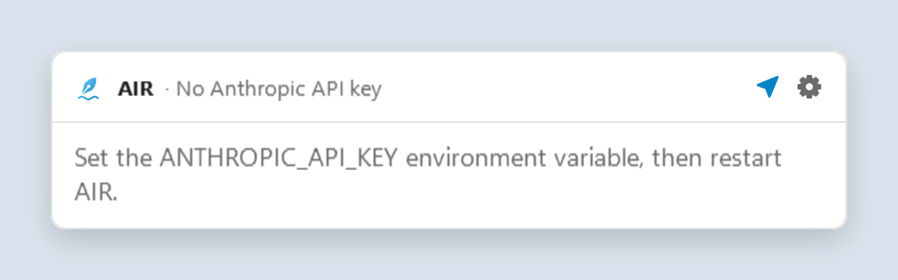

# Engines

AIR asks a language model for each version. It has three engines, chosen in the settings window (its Engine page)
or with `Engine` in `settings.json`:

- **Built-in** (the default): the open model Qwen2.5 7B Instruct, run by AIR itself. Nothing else to install; the
  model is downloaded once from the settings.
- **Ollama**: the same model, `qwen2.5:7b`, or another one, running in [Ollama](https://ollama.com).
- **Claude**: Anthropic's models through the [Anthropic API](https://platform.claude.com/docs/en/build-with-claude/overview), called
  with the official Anthropic SDK for .NET. **Not validated yet:** it was tested only against a fake Anthropic API
  (the unit tests); no live call has been made ([TODO](../TODO.md#not-validated-yet)).

Only the engine in the settings is created. With Claude, AIR never starts, checks or calls Ollama, and no Ollama
state ("Ollama is not running") ever shows; with the built-in engine or Ollama, nothing goes to Anthropic.

## Reference machine

AIR was built and tested on one PC, and every measurement in these docs comes from it:

- Windows 11 x64, .NET SDK 11.0.100 (9.0.315 for the measurements before 2026-11-23), Ollama 0.40.16
- a 12 GB desktop GPU
- a 24-core desktop CPU
- 64 GB of RAM

Other configurations (other GPUs, CPU-only laptops, Windows 10) were not tested yet
([TODO](../TODO.md#not-validated-yet)).

## Which one

| | Built-in (default) | Ollama | Claude |
|---|---|---|---|
| Where the model runs | inside AIR, on your PC | in Ollama, on your PC | at Anthropic |
| What you install | nothing beyond AIR; the model once from the settings (a 4.7 GB download) | Ollama, and the model once (a 4.7 GB download) | nothing beyond AIR |
| Video memory (reference machine) | 4.7 GiB with the model on the GPU | 4.6 GiB with the model loaded on the GPU; none when it runs on the CPU | none |
| RAM while loaded (reference machine) | about 770 MiB beside the video memory | about 750 MiB beside the video memory, or about 4.6 GiB on the CPU only | none |
| Speed (reference machine) | a median of 0.44 s per version on the GPU (Vulkan) | a median of 0.13 s per version on the GPU, 4.0 s on the CPU only | not measured |
| Internet | only for the download | not needed | needed |
| Account and credential | none | none | an Anthropic API key, or an `ant auth login` profile (below) |
| Cost | free | free | billed per token by Anthropic, see [pricing](https://platform.claude.com/docs/en/about-claude/pricing) |
| The sentence you type | stays on your PC | stays on your PC (or goes to the Ollama machine you set) | goes to Anthropic's API |

Both run Qwen2.5 7B Instruct at 4 bits. With Ollama's copy the built-in engine writes Ollama's versions; with its own
download (the Qwen team's file) the versions differ often, at the same quality in a blind check
([MODELS.md](MODELS.md#the-downloaded-file-and-ollamas)). Ollama is faster on an NVIDIA GPU (CUDA against Vulkan) and
lets you pick another model.

## Built-in

### The model

Qwen2.5 7B Instruct, made by the Qwen team at Alibaba Cloud under the Apache License 2.0: the GGUF file quantized to
4 bits (Q4_K_M) that the Qwen team publishes in
[Qwen/Qwen2.5-7B-Instruct-GGUF](https://huggingface.co/Qwen/Qwen2.5-7B-Instruct-GGUF) on Hugging Face, in two parts,
4.7 GB in all. It is the same model as Ollama's `qwen2.5:7b`, quantized separately: the two files write different
versions of about two sentences in three, and a blind check scored them the same
([MODELS.md](MODELS.md#the-downloaded-file-and-ollamas)). AIR wraps the prompts tuned on Ollama
([PROMPTS.md](PROMPTS.md)) the way Ollama does for this model and decodes greedily, as Ollama does at temperature 0.
This engine has no other model to pick; another model means Ollama.

### Getting the model

AIR looks for the model in this order:

1. `%LocalAppData%\AiInlineRewrite\models`, where its own download goes. Installed from the Microsoft Store, AIR
   keeps it in its package storage instead, and uninstalling deletes it.
2. Ollama's copy of `qwen2.5:7b`, when Ollama pulled it on this PC (in `%USERPROFILE%\.ollama\models`, or the folder
   in `OLLAMA_MODELS`). AIR reads Ollama's manifest, checks that the file is the exact one it expects, and loads it
   from there without copying it. Ollama does not need to be running.
3. Neither: the bubble and the settings say the model is missing, and the settings offer **Download (4.7 GB)**. On the
   first run, AIR opens the settings there.

The download goes straight to Hugging Face, part by part. When the connection drops, or goes a minute without a byte,
AIR tries again by itself from where it stopped, waiting 2 s, then 4, 8 and so on up to a minute; it gives up after 8
tries in a row that bring nothing, and the button offers to try again. A download stopped by Cancel or by closing AIR
also resumes where it stopped. Each part is checked against its SHA-256 before AIR uses it; a damaged part is
deleted. (Fetching these files on 2026-11-23, Hugging Face closed the connection several times and sometimes
slowed to a few KB/s, so expect a break or two.) The settings show how far it is, and the bubble says the model is downloading.
When it ends, AIR is ready with no restart.

### Running it

AIR runs llama.cpp through [LLamaSharp](https://github.com/SciSharp/LLamaSharp) 0.30.0 (MIT), with two native builds
next to the exe: Vulkan, for a GPU with a Vulkan driver (NVIDIA, AMD, Intel), and the CPU. It loads the model as soon
as it finds it (when AIR starts, when the engine is picked, when the download ends): all layers on the GPU, else 16 of
them, else none (the CPU alone). On the reference machine loading took
about 2 s, with all 29 layers on the GPU. After 30 minutes without a rewrite, AIR frees the model and its memory; the
next pause loads it again.

When the model cannot run (not enough memory, most likely), the bubble says "The model could not run" and asks to
close programs that use a lot of memory. The diagnostic log (`DiagnosticLog`) records the device llama.cpp picked and
how many layers went to the GPU.

### Check it on your PC

`AiInlineRewrite.exe --check-builtin result.md` runs sample sentences through every tone with the built-in engine and
writes a table with each version and its time, plus the llama.cpp log next to it (`result.log`, with the device). It
exits 0 when every version was written, 1 when one failed, and 2 when the model is missing.

### Without a video card (built-in)

**Not validated yet:** the CPU fallback was not run in the app ([TODO](../TODO.md#not-validated-yet)). The probe this
engine came from took 3.5 s a version on the reference CPU with 8 threads ([MODELS.md](MODELS.md)); AIR uses half the
logical cores, up to 8.

## Ollama

### The default model

`qwen2.5:7b` is Qwen2.5 7B Instruct, made by the Qwen team at Alibaba Cloud and published under the Apache License 2.0
(`ollama show qwen2.5:7b --license` prints it). In Ollama's library it is 7.6 billion parameters quantized to 4 bits
(Q4_K_M), a 4.7 GB download. The prompts were tuned on it ([PROMPTS.md](PROMPTS.md)): on the reference machine it
follows the shape rules, translates the Portuguese samples and answers a sentence in a fraction of a second on the
GPU. Ollama itself is open source under the MIT license.

### Another Ollama model

Pull it, then pick it in the settings window: the Engine page lists the models Ollama has installed, and a new
model applies at once. Or set it in `settings.json` while AIR is closed:

```powershell
ollama pull llama3.1:8b
```

```json
{ "OllamaModel": "llama3.1:8b" }
```

The prompts were tuned on `qwen2.5:7b`, so check another model with `tools/ToneCheck` first (the next section has
three); each model has its own license, shown by `ollama show <model> --license`. `OllamaEndpoint` points AIR at
Ollama on another machine (`http://gpu-box:11434`); the sentence then travels there over plain HTTP
([SECURITY.md](../SECURITY.md)).

### Other models

[MODELS.md](MODELS.md) compares eight models by blind-judged quality, speed on the GPU and the CPU, size and
license (2026-11-23), and measures llama.cpp running inside a .NET process next to Ollama.

Results on the reference machine, 2026-11-21: `tools/ToneCheck` with the app's prompts, the ten samples through all
five tones (50 versions, one at a time), each model loaded alone and stopped after its run.

| Model | Size | First load | `ollama ps` | More video memory in use (`nvidia-smi`) | 50 versions | Median | Slowest |
|---|---|---|---|---|---|---|---|
| `qwen2.5:7b` (the default) | 7.6B, Q4_K_M | 2.0 s | 4.8 GB, 100% GPU | 4.6 GiB | 6.5 s | 0.13 s | 0.21 s |
| `qwen3-vl:8b-instruct` | 8.8B, Q4_K_M, vision | 3.7 s | 5.8 GB, 100% GPU | 6.7 GiB | 7.4 s | 0.14 s | 0.29 s |
| `qwen3-vl:8b` | 8.8B, Q4_K_M, vision, thinking | 5.3 s | 5.8 GB, 100% GPU | 7.0 GiB | 116.2 s | 2.29 s | 2.53 s |
| `gemma4:12b` | 11.9B, Q4_K_M, vision, thinking | 4.6 s | 1.1 GB, 100% GPU | 8.5 GiB | 94.1 s | 1.86 s | 2.10 s |

`ollama show` lists the Apache License 2.0 for all four. For `gemma4:12b`, `ollama ps` reported 1.1 GB while
`nvidia-smi` showed 8.5 GiB more in use; both numbers are as the tools printed them.

What the answers showed:

- **`qwen2.5:7b`**: as in [PROMPTS.md](PROMPTS.md), no answer outside English. It stays the default.
- **`qwen3-vl:8b-instruct`**: every answer in English, most of them close to the default's, but with problems the
  default does not have on these samples:
  - Diplomatic reversed the meaning of "Me manda o arquivo quando puder" into "I'll send you the file when I can".
  - Ornate added clauses that were not in the sentence, such as "for its resolution demands greater deliberation
    than presently allotted".
  - Concise left "friday" in lowercase; Casual answered "I think we gotta talk about the deadline tomorrow".
  - It writes curly apostrophes (we’re) where the default writes straight ones.
- **`qwen3-vl:8b` and `gemma4:12b`** (thinking models): no usable version. Every answer came back empty, or as the
  user's final punctuation alone ("!", "?", "."). A request with the Casual prompt, made by hand, shows why: the model
  spent all 256 tokens AIR allows per answer (`num_predict`) on its thinking (`done_reason: length`), so the answer
  was empty. Asking with `"think": false` did not stop `qwen3-vl:8b` from thinking. These models do not work with AIR
  as it is ([TODO](../TODO.md)). ToneCheck counts answers that left English, not empty ones, so its summary line
  reported "0 left English" for both.

### What it costs while it sits there

Measured on the reference machine on 2026-11-21, using the app's own settings (a 4096-token context):

| | Nothing loaded | Loaded on the GPU | Loaded on the CPU only |
|---|---|---|---|
| `ollama ps` | nothing | `4.8 GB`, `100% GPU` | `5.1 GB`, `100% CPU` |
| Video memory in use (`nvidia-smi`) | 2,560 MiB | 7,271 MiB (4,711 MiB more) | 2,556 MiB (no change) |
| RAM of the model runner (`llama-server`, working set) | none | 750 MiB | 4,759 MiB |
| RAM of the Ollama server and its tray app (working set) | about 110 MiB | the same | the same |
| GPU power, idle | 23.5 W | 24.5 W | |
| Load time (warm disk cache) | | 2.0 to 2.5 s | 3.1 s |

Sitting there, the loaded model held memory and drew about 1 W more: 20 seconds after the last version, the GPU drew
24.5 W, against 23.5 W with nothing loaded.

**How long it stays loaded.** Ollama's own default is 5 minutes after the last request (`OLLAMA_KEEP_ALIVE` changes
that default). AIR asks for 30 minutes on every request (`keep_alive: "30m"`, `OllamaClient.KeepAlive`), which
overrides that default, and loads the model once when it starts, so the first version is quick. So the model is
loaded from the moment AIR starts, while you type, and until 30 minutes after your last pause.

**Freeing it.**

```powershell
ollama ps                  # what is loaded, and until when
ollama stop qwen2.5:7b     # unload it now
```

Quit AIR first, or turn it off in the tray: otherwise the next pause loads the model again (2.0 to 2.5 s on the
reference machine's GPU). Quitting Ollama from its tray icon frees everything. A shorter time needs
`OllamaClient.KeepAlive` changed and a rebuild; a setting for it is on the [roadmap](../TODO.md).

Only the reference machine's 12 GB GPU was measured; how other cards fit the model was not tested
([TODO](../TODO.md#not-validated-yet)).

### Without a video card

Ollama runs the same model on the CPU, from RAM (about 4.6 GiB on the reference machine). On the reference machine's
24-core CPU alone, with the app's prompts: 3.1 s to load, then a median of 4.0 s per version (the slowest 4.2 s, about
16 tokens per second), one version at a time. The app asks for every enabled tone at once; how long a full bubble
takes on the CPU, and how other CPUs and laptops do, was not measured ([TODO](../TODO.md#not-validated-yet)).

### Speed on a GPU

`tools/ToneCheck` on the reference machine's GPU, one version at a time after the load: the ten sample sentences
through all five tones, 50 versions, took 6.3 s and 6.5 s in two runs, a median of 0.13 s each and 0.20 to 0.21 s for
the slowest.

## Claude

**Not validated yet:** everything in this section was tested only against a fake Anthropic API (the unit tests). No
live call has been made: not the app with Claude, not `tools/ToneCheck --engine claude`
([TODO](../TODO.md#not-validated-yet)).

### Models

The default is `claude-haiku-5-5` (Claude Haiku 5.5): a version is one short sentence, and Anthropic's
[model overview](https://platform.claude.com/docs/en/about-claude/models/overview) presents Haiku as its fastest
model. The settings window offers three:

| `ClaudeModel` | Model |
|---|---|
| `claude-haiku-5-5` | Claude Haiku 5.5 (the default) |
| `claude-sonnet-5-5` | Claude Sonnet 5.5 |
| `claude-opus-5-5` | Claude Opus 5.5 |

Another id from Anthropic's model list can be set as `ClaudeModel` in `settings.json`; the window then shows it
first. The prompts are the same ones Ollama gets, split the Messages way: the tone's instructions as the system
prompt and the sentence as the user message ([PROMPTS.md](PROMPTS.md)).

### Set it up

1. **A credential.** Create an API key in the [Claude Console](https://platform.claude.com/settings/keys) and store
   it as a user environment variable named `ANTHROPIC_API_KEY`: in *Settings > System > About > Advanced system
   settings > Environment Variables*, or in PowerShell (it asks for the key, so it does not land in the shell
   history):

   ```powershell
   [Environment]::SetEnvironmentVariable('ANTHROPIC_API_KEY', (Read-Host 'Anthropic API key'), 'User')
   ```

2. **AIR, started after it.** A program sees the environment variables it was started with, so quit AIR if it is
   running and start it from the Start menu or Explorer (a terminal opened before step 1 does not have the variable
   yet).
3. **The engine.** In the settings window, pick Claude on the Engine page, and the model. It applies at once.
   Or, with AIR closed, set it in `%AppData%\AiInlineRewrite\settings.json` (create the file if it is not there yet;
   the fields left out keep their defaults):

   ```json
   { "Engine": "Claude", "ClaudeModel": "claude-haiku-5-5" }
   ```

**Where the credential comes from.** AIR does not read it itself: the Anthropic SDK does, in this order:
`ANTHROPIC_API_KEY`, then `ANTHROPIC_AUTH_TOKEN`, then a profile in `%APPDATA%\Anthropic` (or `ANTHROPIC_CONFIG_DIR`),
which is where the Anthropic CLI keeps the sign-in of `ant auth login`. That order was read in the SDK's own code
(the `Anthropic` package 13.12.0), and the tests check that AIR sends a profile's token when no key is set and sends
nothing when there is no credential at all. A real `ant auth login` was not tried yet
([TODO](../TODO.md#not-validated-yet)). AIR never writes the credential to `settings.json` or to the log, and the
settings window never asks for it.

### What goes to Anthropic

At each pause, one Messages API request per enabled tone (three by default), streamed: the tone's instructions and the
sentence you are typing, nothing else (not the rest of the field, not the app, not who you write to). Anthropic's
terms and privacy policy apply to what it receives. When the engine is created (at start, and when you pick Claude or
another Claude model), AIR looks the model up in the Models API to check the credential and the model id; that lookup
sends no text.

**Cost.** Anthropic bills each request by its input and output tokens, at the model's price on the
[pricing page](https://platform.claude.com/docs/en/about-claude/pricing). Every pause costs one request per enabled
tone, so turning off the tones you do not use means fewer requests.

**Speed** was not measured; `tools/ToneCheck --engine claude` measures it on your connection.

### When something is wrong

The bubble and the settings window name the problem and the one step that fixes it:

| The bubble says | What to do |
|---|---|
| No Anthropic API key | Set the `ANTHROPIC_API_KEY` environment variable, then restart AIR. |
| The Anthropic API key was refused | Check `ANTHROPIC_API_KEY` in the Anthropic Console, then restart AIR. |
| Claude cannot be reached | Check the internet connection, then type again. |
| The model ... does not exist | Choose another model in the settings, such as Claude Haiku 5.5. |
| Claude is not answering | Wait a moment and type again; if it goes on, check your Anthropic account. |

<div align="center">



</div>

A rate limit (429) or an overloaded API (529) shows as "not answering"; the next pause tries again. A profile whose
files cannot be read shows as a refused key.

## Other backends

Built in: the built-in engine, Ollama (with any model it serves, local or on another machine) and Claude. Other
servers (LM Studio, llama.cpp's server, vLLM, OpenAI-compatible APIs, other cloud providers) are not built in.

An engine is one class behind one interface, `IRewriteEngine` in `src/AiInlineRewrite/Llm/` (the built-in one lives
in `src/AiInlineRewrite/Local/`): `RewriteAsync` streams a
version, `CheckAsync` says whether it can write now, `PreloadAsync` gets it ready. A new one is that class, a value in
`EngineKind`, a case in `RewriteEngines.Create`, its choices in `EngineChoices`, its status texts in `EngineStatus`,
and tests against a fake HTTP handler like `OllamaClientTests` and `ClaudeClientTests`.

## Docker

**AIR cannot run in a container.** It is a Windows desktop app: it needs the interactive desktop for its windows, a
low-level keyboard hook, UI Automation to read the field in another app, and `SendInput` to paste. Windows containers
have no desktop session, and Linux containers have none of these.

**Ollama can.** **Not validated yet:** the steps below follow the documentation of Ollama's official image,
[`ollama/ollama`](https://hub.docker.com/r/ollama/ollama), and were not run for this release; AIR was tested against
a native Ollama only ([TODO](../TODO.md#not-validated-yet)). On Windows, an NVIDIA GPU reaches the container through
WSL2: Docker Desktop with the WSL2 backend, or Docker Engine inside WSL2 with the NVIDIA Container Toolkit. Then:

```powershell
docker run -d --gpus=all -v ollama:/root/.ollama -p 11434:11434 --name ollama ollama/ollama
docker exec ollama ollama pull qwen2.5:7b
```

The container publishes Ollama on port 11434, the port of AIR's default endpoint, `http://localhost:11434`.

## Platforms

- **Built and tested on** the [reference machine](#reference-machine): Windows 11 x64 with the .NET SDK 11.0.100. CI
  builds, tests and publishes on GitHub's `windows-latest` runners.
- **Windows 10 x64**: AIR was not tested on it ([TODO](../TODO.md#not-validated-yet)).
- **Linux and macOS: no.** WPF and WinForms are Windows-only, and what AIR does is Windows itself: low-level hooks
  (`SetWindowsHookEx`), UI Automation of other apps' text fields, `SendInput` and the Win32 clipboard. It would be a
  different app, not a port. The pure logic and the engine clients are plain .NET, and their tests target plain
  `net11.0`, but they were run on Windows only.
- **The built-in engine** ships the Windows x64 builds of llama.cpp only.
- Ollama and the Anthropic API serve clients on any platform; only AIR is Windows-only.
